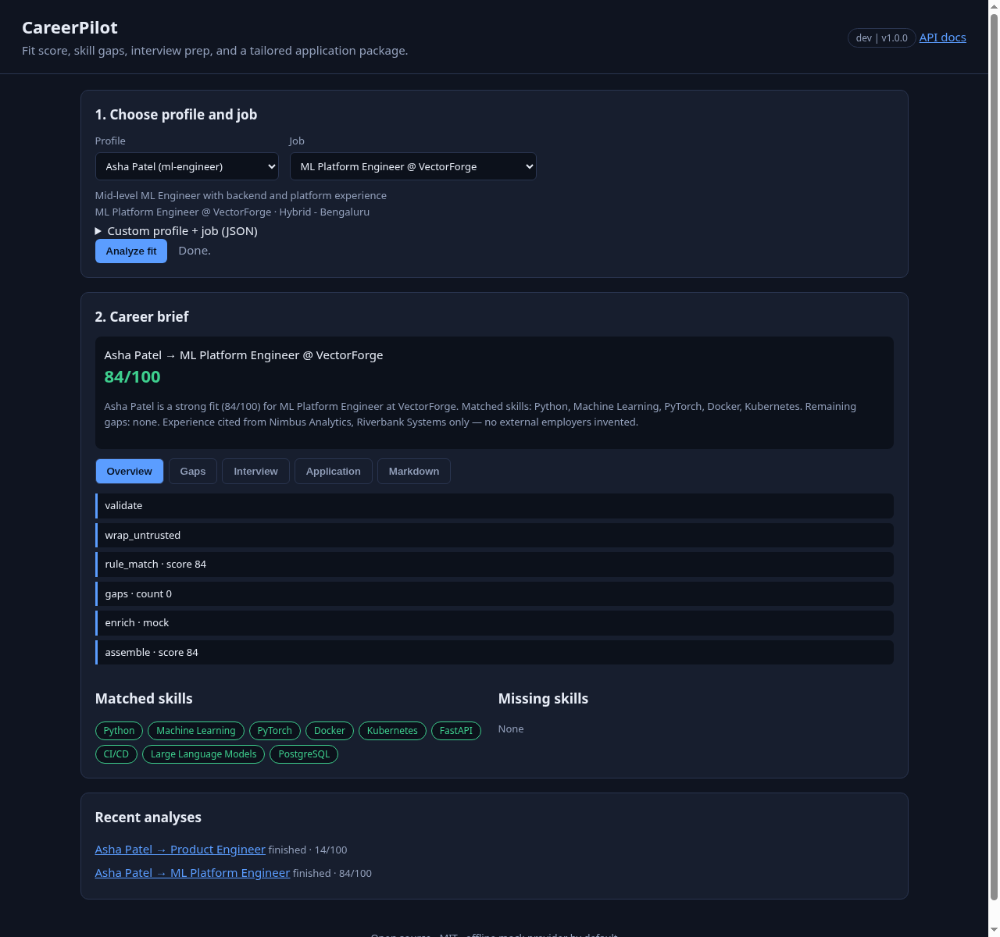
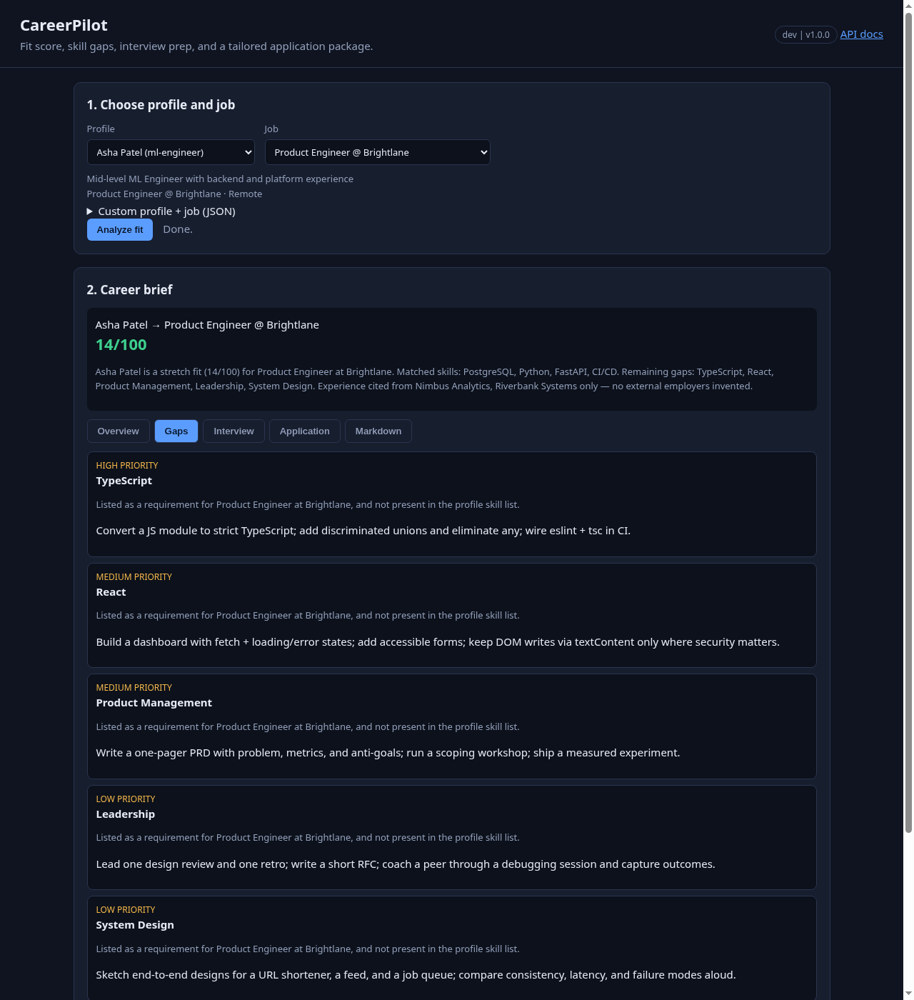
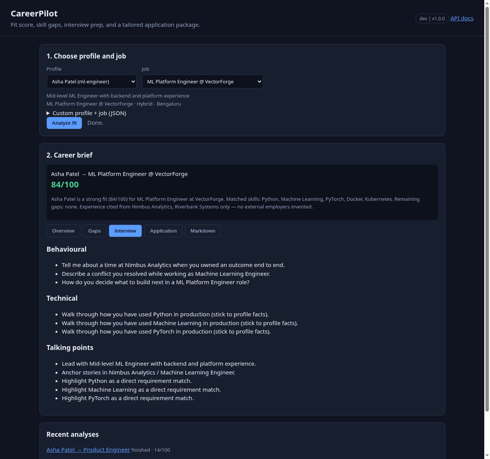
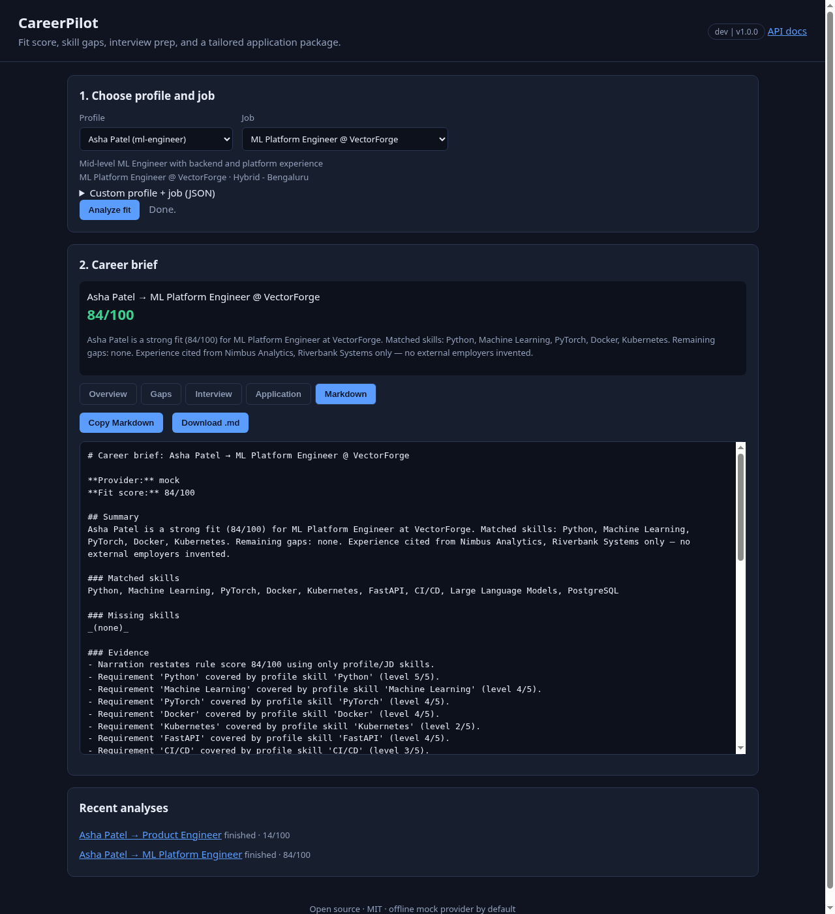
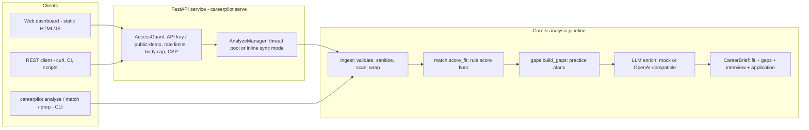
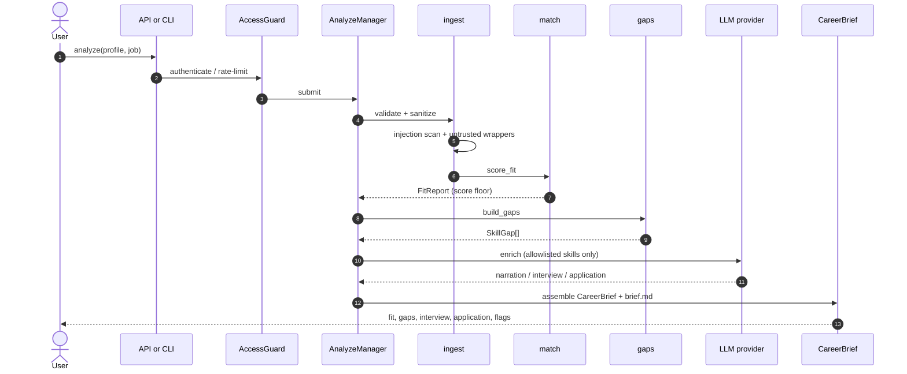

# CareerPilot - personal AI career agent

[](https://github.com/bharatkumar00797/careerpilot-ai-agent/actions/workflows/ci.yml)


**CareerPilot is an AI/LLM agent that turns a structured career profile and a job
description into a fit score with evidence, a skill-gap practice plan, an interview
prep pack, and a tailored application package.**

It works fully offline by default with a deterministic **mock** provider, so demos,
tests and every deployment run without paid keys. Any OpenAI-compatible API
(OpenAI, Groq, Ollama) can be plugged in for narration. Safety never depends on the
model: rules produce the score floor, and the model may only restate allowlisted
skills — it never invents employers, titles, or unverifiable metrics.



## Contents

- [The problem](#the-problem)
- [Features](#features)
- [Screenshots](#screenshots)
- [Architecture](#architecture)
- [How an analysis works](#how-an-analysis-works)
- [Demo outcomes](#demo-outcomes)
- [LLM providers](#llm-providers)
- [Quick start](#quick-start)
- [REST API](#rest-api)
- [Security model](#security-model)
- [Deployment](#deployment)
- [Configuration](#configuration)
- [Project layout](#project-layout)
- [Testing](#testing)
- [Roadmap](#roadmap)
- [Contributing](#contributing)
- [License](#license)

## The problem

Job seekers drown in busywork whenever a new posting appears: skim the JD, guess how
well their resume matches, invent a tailored cover letter, and rehearse interview
answers — often under time pressure. Large language models make that faster, but they
also invent employers, inflate metrics, and follow prompt-injection instructions buried
in a pasted JD. A fabricated "led a 40-person team at Acme" bullet is worse than no
bullet at all.

CareerPilot keeps the useful part (structured fit, gaps, interview and application
drafts) while refusing the dangerous part. Scoring is deterministic and evidence-backed.
Anything the model writes is constrained to skills and employers already present in the
profile or job. Profile and JD text are wrapped as untrusted data and scanned for
injection patterns before they reach the provider.

## Features

- **Rules-first fit score**: skill overlap weighted by level, must-have coverage,
  title / target-role overlap and an experience-years heuristic produce a 0–100 floor
  before any model call.
- **Skill-gap plans**: missing required skills become prioritised rows with practice
  plans from a curated map (Python, SQL, system design, Kubernetes, leadership, ML
  stack, …) plus a generic fallback.
- **Interview pack**: behavioural and technical questions plus talking points anchored
  in real profile employers and titles — never invented companies.
- **Application package**: tailored bullets drawn from profile experience text, a cover
  outline, and keywords to mirror that already exist in the profile or matched set.
- **Injection scan + untrusted wrappers**: profile text in `<untrusted-profile>`, JD in
  `<untrusted-job>`; delimiter look-alikes defanged; hits recorded as `security_flags`.
- **No invented facts**: the model may narrate and rank within allowlisted skills only.
- **Offline by default**: deterministic mock provider; OpenAI / Groq / Ollama optional.
- **REST API + dashboard**: FastAPI with api-key / dev / public-demo modes, live event
  timeline, Markdown brief export, `#analyze=&tab=` deep links; hardened multi-platform
  deploy configs.

## Screenshots

Dashboard deep links use `#analyze=<id>&tab=<name>` (`overview`, `gaps`, `interview`,
`application`, `brief`).

| Fit overview (ml-engineer × ml-platform) | Skill gaps (stretch: product-engineer) |
| --- | --- |
|  |  |

| Interview pack | Markdown brief |
| --- | --- |
|  |  |

## Architecture



| Layer | Module | Responsibility |
| --- | --- | --- |
| Interfaces | `cli.py`, `api/` | CLI, REST API, dashboard, auth, rate limiting, analyze lifecycle |
| Orchestration | `engine.py` | `CareerPilot.analyze` pipeline + Markdown render |
| Domain | `ingest.py`, `match.py`, `gaps.py`, `models.py` | load/sanitize/scan, fit score, practice plans, pydantic models |
| Decision | `llm/` | Protocol, MockProvider, OpenAICompatibleProvider |
| Config | `config.py`, `api/settings.py` | `CAREERPILOT_*` provider and service settings |

## How an analysis works



Step by step:

1. **Validate** the structured profile and job (pydantic `extra=forbid`, size caps).
2. **Sanitize and scan** free-text fields; record injection-pattern hits as
   `security_flags` (data, not instructions).
3. **Wrap** profile text in `<untrusted-profile>` and JD text in `<untrusted-job>`,
   defanging delimiter look-alikes.
4. **Score** with deterministic rules — that number is the fit floor.
5. **Build gaps** for missing required skills with prioritised practice plans.
6. **Enrich** via the configured LLM (mock by default): summary, interview questions,
   application bullets — constrained to allowlisted skills and real employers.
7. **Assemble** a `CareerBrief` and render `brief.md` for download or API fetch.

## Demo outcomes

Packaged profiles and jobs (mock provider):

| Profile | Job | Approx score | Story |
| --- | --- | --- | --- |
| `ml-engineer` | `ml-platform` | ~84 | Strong fit, no required gaps |
| `ml-engineer` | `senior-backend` | ~65 | Good fit; System Design gap |
| `ml-engineer` | `product-engineer` | ~14 | Stretch; React / TypeScript / PM / Leadership gaps |
| `fullstack-pm-hybrid` | `product-engineer` | ≥65 | Strong product-engineer fit |

```bash
careerpilot analyze ml-engineer ml-platform
careerpilot analyze ml-engineer product-engineer
careerpilot analyze fullstack-pm-hybrid product-engineer
```

## LLM providers

| Provider | When to use | Notes |
| --- | --- | --- |
| `mock` (default) | demos, tests, CI, public demo | Deterministic templates; no network |
| `openai` | OpenAI or any compatible API | Set `CAREERPILOT_BASE_URL` + key |
| Groq | Fast hosted models | `BASE_URL=https://api.groq.com/openai/v1` |
| Ollama | Local models | `BASE_URL=http://localhost:11434/v1`, key optional |

```bash
# OpenAI
export CAREERPILOT_PROVIDER=openai
export CAREERPILOT_API_KEY=sk-...
export CAREERPILOT_MODEL=gpt-4o-mini

# Groq
export CAREERPILOT_PROVIDER=openai
export CAREERPILOT_BASE_URL=https://api.groq.com/openai/v1
export CAREERPILOT_MODEL=llama-3.3-70b-versatile
export CAREERPILOT_API_KEY=gsk_...

# Ollama (local, no key needed)
export CAREERPILOT_PROVIDER=openai
export CAREERPILOT_BASE_URL=http://localhost:11434/v1
export CAREERPILOT_MODEL=llama3.1
export CAREERPILOT_API_KEY=ollama
```

Public-demo mode always forces the mock, whatever the environment says. The model only
ever narrates within skills already present in the profile or job; invented employers
and metrics are out of scope by design.

## Quick start

```bash
git clone https://github.com/bharatkumar00797/careerpilot-ai-agent.git
cd careerpilot-ai-agent
python -m venv .venv && source .venv/bin/activate
pip install -e ".[dev]"

careerpilot profiles
careerpilot jobs
careerpilot analyze ml-engineer ml-platform
careerpilot match ml-engineer senior-backend
careerpilot serve --dev                  # dashboard on http://127.0.0.1:8000
```

The default provider is a deterministic offline mock — no API keys required.

CLI commands beyond `analyze`:

| Command | Purpose |
| --- | --- |
| `careerpilot profiles` | List packaged profile ids |
| `careerpilot jobs` | List packaged job ids |
| `careerpilot match <profile> <job>` | Fit report only (no LLM enrich) |
| `careerpilot prep <profile> <job>` | Interview pack |
| `careerpilot package <profile> <job>` | Application package |
| `careerpilot analyze <profile> <job>` | Full CareerBrief + Markdown |
| `careerpilot serve [--dev]` | HTTP API + dashboard |

## REST API

Interactive docs are at `/docs` (OpenAPI at `/openapi.json`).

| Method | Path | Purpose |
| --- | --- | --- |
| GET | `/healthz` | Liveness + version |
| GET | `/api/config` | Access mode, provider name, limits (never credentials) |
| GET | `/api/profiles` | Packaged profile summaries |
| GET | `/api/profiles/{id}` | Full packaged profile |
| GET | `/api/jobs` | Packaged job summaries |
| GET | `/api/jobs/{id}` | Full packaged job |
| POST | `/api/analyze` | `{"profile_id","job_id"}` or custom JSON → 202 async / 200 sync |
| GET | `/api/analyze` | Analyses visible to the caller |
| GET | `/api/analyze/{id}` | Analysis detail + brief snapshot |
| GET | `/api/analyze/{id}/events?since=N` | Event timeline after cursor `N` |
| GET | `/api/analyze/{id}/brief.md` | Markdown brief (after finish) |

```bash
curl -s -X POST localhost:8000/api/analyze -H 'Content-Type: application/json' \
  -d '{"profile_id":"ml-engineer","job_id":"ml-platform"}'
curl -s "localhost:8000/api/analyze/<id>/events?since=0"
curl -s "localhost:8000/api/analyze/<id>/brief.md"
```

### Access modes

| Mode | When | Behaviour |
| --- | --- | --- |
| **api-key** | `CAREERPILOT_API_KEYS` set | `X-API-Key` or `Authorization: Bearer` required; callers may use the configured LLM provider |
| **dev** | `CAREERPILOT_DEV_MODE=true` / `serve --dev` | No auth; full access; localhost only |
| **public-demo** | neither | Anonymous, packaged profiles/jobs + mock only, per-client (hashed IP) ownership |

Analyses use a bounded background worker pool (`POST` → `202`, poll events). With
`CAREERPILOT_SYNC_RUNS=true` (automatic on Vercel / AWS Lambda) they finish inside the
request (`200` with the finished brief + full event list).

### Error codes

| Status | When |
| --- | --- |
| `401` | missing or unknown API key |
| `403` | public-demo forbids real providers or custom inputs |
| `404` | unknown analysis / profile / job |
| `409` | brief requested before the analysis finished |
| `413` | request body over 64 KB (Content-Length or streamed) |
| `422` | unknown packaged id, invalid input |
| `429` | general or analyze-creation rate limit exceeded (`Retry-After`) |
| `503` | analyze queue full |

## Security model

An agent that drafts career materials from untrusted JD text needs hard boundaries.
CareerPilot layers several guards; none of them is a silver bullet.

| Layer | Control |
| --- | --- |
| Model output | Narrates and ranks within allowlisted skills only; never invents employers, titles, or unverifiable metrics |
| Untrusted input | Profile and JD free text wrapped in `<untrusted-profile>` / `<untrusted-job>` with `<` escaped so content cannot close the block or look like instructions |
| Injection scan | Pattern hits become `security_flags` on the brief (treated as data, not instructions) |
| Score floor | Deterministic rules produce the fit score before any model call |
| HTTP | API keys as SHA-256 digests compared with `hmac.compare_digest`; sliding-window rate limits (general + stricter analyze creation); pydantic `extra=forbid`; 64 KB body cap (header and streamed); strict CSP + security headers; `no-store` on `/api`; env-driven CORS; right-most `X-Forwarded-For` only behind `CAREERPILOT_TRUST_PROXY` |
| Public demo | Mock forced; packaged profiles/jobs only; ownership scoped to `anon:` + `sha256(client_ip)[:12]` |
| Dashboard | All server data rendered with `textContent` (no HTML sinks) |
| Container | Non-root uid 10001, read-only rootfs, tmpfs `/tmp`, `cap_drop: ALL`, `no-new-privileges`, pids / mem / CPU limits |
| Secrets | Provider keys only from the environment; never returned in any response (tested) |

**Residual risks** (stated honestly):

- Career briefs are **drafts**. They do not apply to jobs, send emails, or mutate your
  resume files unless you deliberately copy the Markdown.
- State (analyses, rate limits, ownership) lives **in memory** per process: lost on
  restart, and on serverless a follow-up request may land on a fresh instance and
  return `404`. Prefer a container platform for anything beyond a single-request demo.
- Practice plans and interview questions are **heuristics**. A real LLM may still
  phrase awkward advice; the untrusted wrappers and allowlisted-skill constraint are
  the backstop, not model correctness.
- Behind a reverse proxy without `CAREERPILOT_TRUST_PROXY=true`, all public-demo
  visitors share one identity. With it set, trust only proxies you control.
- The mock provider is safe by construction; treat hosted-model output as advisory
  narration only.

See [SECURITY.md](SECURITY.md) for how to report a vulnerability.

## Deployment

All container platforms build the same hardened, non-root image (`Dockerfile`) and
probe `/healthz`; the server listens on `$PORT`. Without API keys every deployment is
a public demo. Lock a deployment down by setting `CAREERPILOT_API_KEYS` as a platform
secret.

### Long-running container vs serverless

| | Container (Docker / Render / Fly / Railway) | Serverless (Vercel) |
| --- | --- | --- |
| Process lifetime | long-lived; background analyses OK | per-request; use sync mode |
| Analysis store | in-memory for the life of the process | in-memory per instance |
| Best for | demos and small shared instances | quick public demos, single-request flows |

### Docker and docker compose

```bash
docker compose up --build --wait
python3 scripts/smoke_test.py http://127.0.0.1:8000
```

Compose runs read-only with all capabilities dropped, a `tmpfs` for `/tmp`, and
memory / pid limits. The image health-checks `/healthz` and honours `$PORT`.
`CAREERPILOT_HOST_PORT` changes the host port (compose only).

Hardened one-shot run:

```bash
docker build -t careerpilot .
docker run --rm -p 8000:8000 --read-only --tmpfs /tmp --cap-drop ALL \
  --security-opt no-new-privileges -e CAREERPILOT_SYNC_RUNS=true careerpilot
```

### Render

`render.yaml` Blueprint: Docker runtime, free plan, health check on `/healthz`,
`CAREERPILOT_PROVIDER=mock`, `CAREERPILOT_TRUST_PROXY=true`. Connect the repo and
Render applies the Blueprint. Add secrets in the dashboard.

### Fly.io

```bash
fly launch --copy-config --no-deploy
fly deploy
```

`fly.toml` sets `PORT=8080` (= `internal_port`), a `/healthz` check and region `bom`.

### Railway

`railway.json` selects the Dockerfile builder, probes `/healthz` and restarts on
failure.

### Vercel

`api/index.py` is the serverless entry; `vercel.json` bundles `src/careerpilot/**`
(data + dashboard) and rewrites every path to the function. Analyses execute in sync
mode because functions cannot keep background threads. Prefer a container platform for
multi-step polling across requests.

## Configuration

All settings are environment variables (see [`.env.example`](.env.example)).

| Variable | Default | Description |
| --- | --- | --- |
| `CAREERPILOT_PROVIDER` | `mock` | `mock` (offline) or `openai` (any OpenAI-compatible API) |
| `CAREERPILOT_MODEL` | `gpt-4o-mini` | Model name for the `openai` provider |
| `CAREERPILOT_BASE_URL` | `https://api.openai.com/v1` | API base URL (Groq, Ollama, OpenRouter, vLLM, …) |
| `CAREERPILOT_API_KEY` | empty | Provider key; sent as a Bearer token, never returned |
| `CAREERPILOT_TIMEOUT` | `60` | Provider HTTP timeout (seconds) |
| `CAREERPILOT_API_KEYS` | empty | Comma-separated keys; enables `api-key` mode |
| `CAREERPILOT_DEV_MODE` | `false` | No auth (localhost only); same as `serve --dev` |
| `CAREERPILOT_CORS_ORIGINS` | empty | Comma-separated browser origins; empty = same-origin only |
| `CAREERPILOT_RATE_LIMIT_PER_MINUTE` | `120` | `/api` requests per key or IP per minute |
| `CAREERPILOT_ANALYZE_LIMIT_PER_MINUTE` | `10` | Analyze-creation limit per key or IP per minute |
| `CAREERPILOT_MAX_CONCURRENT_RUNS` | `2` | Background worker pool size |
| `CAREERPILOT_MAX_QUEUED_RUNS` | `8` | Bounded queue (`503` when full) |
| `CAREERPILOT_MAX_ANALYSES_KEPT` | `200` | In-memory analysis history (oldest evicted) |
| `CAREERPILOT_TRUST_PROXY` | `false` | Use the right-most `X-Forwarded-For` hop |
| `CAREERPILOT_SYNC_RUNS` | `false` (auto-on serverless) | Finish each analysis inside `POST /api/analyze` |
| `CAREERPILOT_HOST_PORT` | `8000` | Host port (docker-compose only; not read by the app) |
| `PORT` / `HOST` | `8000` / `127.0.0.1` (`0.0.0.0` in the container) | Listen address for `careerpilot serve` |

## Project layout

```
src/careerpilot/
  models.py       Profile, JobPosting, FitReport, SkillGap, CareerBrief, …
  ingest.py       Packaged + raw JSON load, sanitize, injection scan, wrappers
  match.py        Deterministic fit scoring
  gaps.py         Practice plans for missing required skills
  llm/            Mock + OpenAI-compatible providers (narrate only)
  engine.py       CareerPilot.analyze pipeline + Markdown render
  cli.py          careerpilot profiles | jobs | match | prep | package | analyze | serve
  config.py       CAREERPILOT_* provider settings
  api/            FastAPI app, settings, auth + rate limits, middleware, jobs, static dashboard
  data/           profiles/ and jobs/ packaged demos
api/index.py      Vercel entrypoint
scripts/          smoke_test.py (stdlib end-to-end check)
tests/            pytest suite
docs/screenshots/ dashboard screenshots
```

## Testing

```bash
ruff check . && ruff format --check . && mypy && pytest
```

CI runs this on Python 3.11, 3.12 and 3.13, then builds the hardened container with
`docker compose up --wait` and runs `scripts/smoke_test.py` against it.

## Roadmap

- Optional persistent analysis store for multi-instance / serverless follow-ups
- Richer practice-plan catalogue and role-family templates
- Export application package as DOCX / PDF without inventing facts
- Batch compare one profile against many jobs with a ranked shortlist

## Contributing

See [CONTRIBUTING.md](CONTRIBUTING.md). Please report security issues privately via
[SECURITY.md](SECURITY.md).

## License

[MIT](LICENSE)
